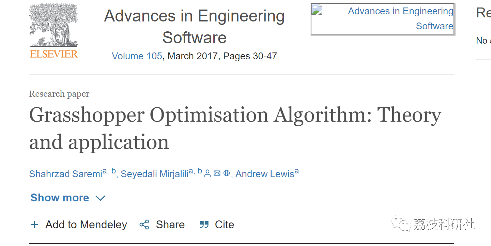
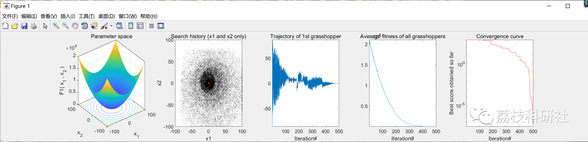

# Optimization Algorithm for Grasshoppers (Matlab Code Implementation)

💥💥💥💞💞💞 Welcome to this blog❤️❤️❤️💥💥💥
🏆 Bloggers' Advantages: 🌞🌞🌞 The content of the blog strives for rigorous thinking and clear logic, making it convenient for readers.
⛳️ Mantra: A journey of a thousand miles is begun with a single step.
Litchi Research Society
Code Collection: Electric power systems, intelligent algorithms and their applications, neural network prediction, path planning, optimization dispatching, workshop scheduling, image processing, signal processing...
🎁 Special Section Link: ​
🌈🌈🌈🌟🌟🌟🌟 Electrical Code Intelligent Algorithms and Their Application Path Planning Neural Network Prediction Optimization Scheduling Image Processing Workshop Scheduling Signal Processing Romantic Her
💥1 Overview
📚2 Run Results
🎉3 References
🌈4 MATLAB Code Implementation
💥1 Overview
This paper proposes a novel optimization algorithm called the Grasshopper Optimization Algorithm (GOA), which is applied to challenging problems in structural optimization. The proposed algorithm simulates and mimics the behavior of grasshoppers in nature to solve optimization problems. GOA is benchmarked on a series of test problems including CEC2005 to qualitatively and quantitatively test and validate its performance. It is then used to find the optimal shape for 52-bar trusses, 3-bar trusses, and cantilever beams, demonstrating its applicability. The results show that compared to known and state-of-the-art algorithms in the literature, the proposed algorithm provides better results. Practical application results also prove the advantages of GOA in solving real-world problems in unknown search spaces.
📚2 Run Results
🎉3 References
🌈4 MATLAB Code Implementation
Click the article's lower left corner [Read Full Article]

## Images

<!-- PAYMENT_BLOCK -->

## Get this dataset

- Payment link (Stripe): [Buy now](https://buy.stripe.com/3cs8yP7sY87d0vu9AB)
- Payment QR code: 

<!-- /PAYMENT_BLOCK -->
